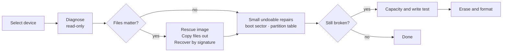

<div align="center">

# DiskRepair

### Diagnose, rescue and repair external storage on Windows.

**USB hard disks, flash drives, SD and microSD cards. Rescue your files first, then fix the device.**

[](#requirements)
[](#requirements)
[](#requirements)
[](#the-safety-guard)

[Quick start](#quick-start) · [How DiskRepair works](#how-diskrepair-works) · [What it can do](#what-it-can-do) · [Safety guard](#the-safety-guard) · [Scenarios](#common-scenarios) · [FAQ](#faq) · [Documentation](#documentation)

<code>DiskRepair.bat</code>

</div>

> [!IMPORTANT]
> DiskRepair works on **external** devices only. Internal disks (SATA, NVMe, RAID and the
> disk that holds Windows) are locked out by design, with no override. Even so, repairs and
> formatting change what is stored on a device: **rescue your files first**.

---

Windows says "You need to format the disk before you can use it". A card shows the wrong size,
or turns read-only. A flash drive that worked yesterday is now empty. DiskRepair reads the
device directly, sector by sector, so it can look past what Windows reports. It tells you in
plain language what is wrong, copies your files out, and applies the smallest repair that
works.

It is a desktop app with a small command line, written in pure Python with nothing to install.
Every action that writes to a device saves the sectors it replaces first, so boot-sector and
partition-table repairs can be undone.

> **[Open the full documentation](DiskRepair-Documentation.html)** for a tab-by-tab guide,
> scenarios, the command line and troubleshooting.

## Quick start

### Requirements

- Windows 10 or 11
- Python 3.9 or newer, with `pythonw` on your `PATH`. Standard library only, so there is
  nothing to `pip install`.
- Administrator rights. Raw disk access is impossible without them.

### Start the app

1. Plug in the device you want to work on.
2. Double-click **`DiskRepair.bat`** (or `DiskRepair.pyw`).
3. Accept the Windows administrator prompt.
4. Select your device in the **External devices** list.
5. On the **Diagnosis** tab, click **Run diagnosis (read-only)**.

If DiskRepair is started without administrator rights it relaunches itself elevated (Windows
shows the prompt). If elevation is declined or fails, the header shows a red "Not running as
administrator" notice and disk access is unavailable.

> [!NOTE]
> Security software can flag raw disk access. If DiskRepair is blocked, add an exclusion for
> its folder.

### Use the terminal

The GUI is the main interface. The command line is for scripting and support, and disk
commands need an elevated prompt:

```bash
python -m diskrepair list
python -m diskrepair diagnose 1                  # a disk number
python -m diskrepair diagnose rescue.img         # or a saved image file
python -m diskrepair diagnose 1 --deep --json report.json
```

| Command    | What it does                                                                                       |
| ---------- | -------------------------------------------------------------------------------------------------- |
| `list`     | External disks and their volumes, the count of protected internal disks, and device problems       |
| `diagnose` | Read-only diagnosis of a disk or image file. `--deep` also searches for lost partitions            |
| `captest`  | Capacity and write test. Needs `--serial` from `list`                                              |
| `format`   | Erase and format. Needs `--serial` and `--erase-all-data`                                          |
| `gui`      | Start the graphical interface (the default)                                                        |

```bash
python -m diskrepair captest 1 --serial ABC123 [--thorough]
python -m diskrepair format 1 --serial ABC123 --erase-all-data --fs exfat --label BACKUP
```

## How DiskRepair works

Diagnosis comes first and changes nothing. It produces findings with severity levels and an
ordered repair plan. You then rescue data, apply small undoable repairs, and only as a last
resort wipe and reformat.



Recovered files, rescue images, logs and sector backups go to `DiskRepair-data\` next to the
program, and are never allowed onto the device being rescued.

## What it can do

| Tab          | Action                                                                                       | Writes to the device?                  |
| ------------ | -------------------------------------------------------------------------------------------- | -------------------------------------- |
| Diagnosis    | Partition table, boot sectors and backups, FAT / exFAT / NTFS checks, surface sample, lost-partition search, plain-language verdict | No |
| Repair       | Clear write protection / bring online                                                        | Flags only                             |
| Repair       | CHKDSK filesystem repair                                                                     | Yes (filesystem)                       |
| Repair       | Restore boot sector from its backup (FAT32, exFAT, NTFS)                                     | A few sectors, undoable                |
| Repair       | Deep search for lost partitions, rebuild MBR / GPT partition table                           | A few sectors, undoable                |
| Repair       | Undo last boot-sector / table change                                                         | Puts saved sectors back                |
| Repair       | Erase and format (FAT32 at any size, exFAT, NTFS), optional zero-fill, write verification    | **Erases everything**                  |
| Recover data | Rescue image that skips and retries bad sectors                                              | No                                     |
| Recover data | Copy files out with a built-in FAT / exFAT reader (works on "RAW" volumes, optional deleted files) | No                               |
| Recover data | Recover photos, videos, PDFs and Office files by signature                                   | No                                     |
| Test         | Full surface scan with a bad-area map                                                        | No                                     |
| Test         | Capacity and write test (finds counterfeit cards and controllers that drop writes)           | Test blocks, then restored             |

### Highlights

- **FAT32 at any size.** DiskRepair has its own formatter, so cards above 32 GB, which Windows
  itself refuses to format as FAT32, work for cameras, consoles and car stereos.
- **Works on "RAW" volumes.** The built-in FAT12/16/32 and exFAT readers copy files out when
  Windows cannot mount the volume, tolerate damaged allocation tables, and can include deleted
  files.
- **Bad-sector tolerant imaging.** Unreadable areas are skipped first, retried in small pieces,
  and left as zeros if they stay unreadable. Work from the image afterwards and spare the
  failing device.
- **File carving.** JPEG, PNG, PDF, ZIP-based Office files, MP4 / MOV / HEIC / 3GP / M4A / CR3,
  and AVI / WAV / WEBP, recovered without any filesystem. Names are lost and fragmented files
  can come out damaged.
- **Counterfeit card detection.** Marker blocks on a power-of-two grid catch both "limbo" fakes
  (writes past the real capacity are dropped) and "wraparound" fakes (the address space
  repeats), and the test reports the real usable size.

## The safety guard

DiskRepair cannot open an internal disk, by design and with no override:

- Only disks on the **USB, SD, MMC or FireWire** bus are accepted. SATA, NVMe, RAID, SAS,
  virtual disks and anything unrecognised are refused.
- Any disk holding Windows, your user profile, the temp folder or DiskRepair itself is refused
  even if it is on USB.
- The check runs on the very handle used for I/O, immediately before every operation, so a
  device swapped between "select" and "go" is caught.
- Writing additionally requires the model + serial + size fingerprint of the device you
  selected.
- The PowerShell commands used for formatting repeat the same check on their side.

Internal disks are counted in the header ("N internal disk(s) hidden and locked out") and are
never listed as targets.

## Common scenarios

| Symptom                                                   | Try this, in order                                                                                      |
| --------------------------------------------------------- | ------------------------------------------------------------------------------------------------------- |
| "You need to format the disk" (RAW)                       | Diagnose, then **Restore boot sector from backup**. If files matter and that fails, **Copy files out** |
| Empty, wrong size or "unallocated"                        | Diagnose, then **Rebuild partition table**. Run **Deep search for lost partitions** if nothing is found |
| "The disk is write protected"                             | Check the lock switch on the SD adapter, then **Clear write protection**                                |
| Files vanish or corrupt after a few GB                    | **Capacity and write test**: a fake-capacity card or a dropping controller explains it                  |
| Card will not open at all and you need the photos         | **Save rescue image**, then **Recover files by signature** from that image                              |

## What software cannot fix

- A device that never appears in the list. It is not answering on the bus (dead controller,
  broken connector). Try another port, cable or card reader.
- A reader that reports "no media" or zero capacity with the card inserted.
- Flash that has locked itself read-only at end of life (the write test reports this).
- Counterfeit capacity. The test shows the real size, but the card cannot be trusted.
- Physically unreadable sectors. They can be skipped and mapped, not healed.

## FAQ

<details>
<summary><strong>Can DiskRepair damage my internal drive?</strong></summary>

No. Internal disks cannot be opened at all. The guard accepts only USB, SD, MMC and FireWire
disks, refuses any disk holding Windows, your profile or the program itself, and re-checks on
the device handle before every operation.

</details>

<details>
<summary><strong>Which order should I use the tools in?</strong></summary>

1. **Run diagnosis.** It is read-only and tells you which of the steps below apply.
2. If the files matter, **Save rescue image** and/or **Copy files out** before any repair.
3. Apply the small, undoable repairs the diagnosis suggests (boot sector, partition table).
4. If nothing else works and the data is safe or not needed, run **Capacity and write test**,
   then **Erase and format**.

</details>

<details>
<summary><strong>Can I undo a repair?</strong></summary>

Boot-sector and partition-table repairs can. The sectors being replaced are saved to
`DiskRepair-data\backups\` first, and **Undo last boot-sector / table change** puts them back.
Erase and format cannot be undone.

</details>

<details>
<summary><strong>Does it upload anything?</strong></summary>

No. Everything runs locally and uses only the Python standard library. Results stay in the
`DiskRepair-data\` folder.

</details>

<details>
<summary><strong>Where do my recovered files go?</strong></summary>

To `DiskRepair-data\recovered\`, one folder per run. Rescue images default to
`DiskRepair-data\images\`, and you can choose another folder on a different disk. DiskRepair
refuses any destination on the device being rescued and checks free space first.

</details>

<details>
<summary><strong>The app says "Access denied". What now?</strong></summary>

Run it as administrator and close any program that is using the device, such as Explorer
windows or antivirus scans.

</details>

## Documentation

- [Full documentation](DiskRepair-Documentation.html): interface tour, every action, scenarios,
  command line, architecture and troubleshooting (open it in a browser).
- `DiskRepair-data\logs\diskrepair-YYYYMMDD.log`: a daily log of everything the app did.

### Project layout

| Path                      | Role                                                                                    |
| ------------------------- | --------------------------------------------------------------------------------------- |
| `DiskRepair.bat` / `.pyw` | Launchers for the GUI                                                                   |
| `diskrepair/safety.py`    | The external-only guard                                                                 |
| `diskrepair/blockdev.py`  | Guarded physical device and file-backed image device                                    |
| `diskrepair/layout.py`    | MBR, GPT and FAT / exFAT / NTFS boot-sector parsing and building                        |
| `diskrepair/diagnose.py`  | Findings, verdict and ordered repair plan                                               |
| `diskrepair/repair.py`    | Boot-sector restore, partition rebuild, undo, format, CHKDSK                            |
| `diskrepair/fsread.py`    | Built-in read-only FAT and exFAT readers                                                |
| `diskrepair/rescue.py`    | Imaging and signature-based carving                                                     |
| `diskrepair/captest.py`   | Capacity and write test                                                                 |
| `diskrepair/gui.py`       | tkinter interface (all disk work runs on a worker thread)                               |
| `diskrepair/cli.py`       | Command-line interface                                                                  |
| `tests/`                  | Simulated-disk test suite                                                               |

## Tests

```bash
python -m unittest discover tests -v
```

The tests build simulated disk images (lost partition table, destroyed boot sector, bad
sectors, fake capacity, stuck controller) and never write to a physical disk.

## Disclaimer

Use DiskRepair only on devices you own or are authorized to repair. Repair, format and test
operations write to the selected device. Keep a rescue image of anything you cannot afford to
lose, and double-check the device name, size and serial before confirming a write. The software
is provided as is, without warranty.

## License

No license has been specified for this project yet.
